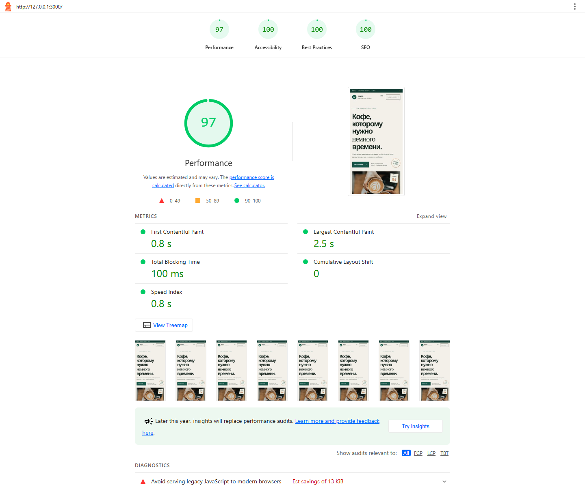

# Кварта — кофе свежей обжарки в Минске

**Сайт:** https://kvarta-brief.netlify.app/ · **Репозиторий:** https://github.com/Alexandch/kvarta-brief

Лендинг минской кофейной мастерской: ассортимент, подписка, доставка, самовывоз и форма заявки. Корзины и онлайн-оплаты нет — менеджер связывается с клиентом.

## Что реализовано

- Адаптивная авторская страница и три сорта с ценами.
- Форма имени, белорусского мобильного номера, интереса и комментария; понятные состояния ошибки и успеха.
- `POST /api/lead` записывает заявку и UTM/click ID. Повторный номер в течение 10 минут блокируется атомарно.
- Локальный PostgreSQL в Docker Compose, production PostgreSQL в Supabase. GitHub Actions проверяет тесты, TypeScript, сборку и мобильный Lighthouse перед production deploy.

## Запуск

Установите Docker Desktop и выполните `docker compose up -d --build`. Сайт: http://localhost:3000. Настройки Supabase, Netlify и тестов — в [DEPLOYMENT.md](DEPLOYMENT.md).

PostgreSQL выбран вместо JSON-файла для надёжной записи, поиска повторов и просмотра заявок; файловая система serverless-хостинга не является постоянной базой.

## Моя работа и ИИ

Я сформулировал требования, выбрал PostgreSQL, Docker Compose и Supabase, развернул сайт на Netlify,правил код и направлял доработки. Codex подготовил большую часть интерфейса, API, SQL-схему, адаптивные стили, контейнеризацию, тесты, CI/CD и документацию.

При финальном сравнении с ТЗ обнаружены и исправлены два пропуска ИИ: не было отдельного выбора «Вопрос», а карточки сортов передавали значения, отсутствовавшие в форме. Lighthouse выявил слабый контраст части текста и несовпадение видимого имени логотипа с его доступной подписью; контраст, подпись и мобильные зоны нажатия улучшены. Проверка Supabase также привела к запрету публичного вызова функции записи и тесту RLS. В первой инструкции ИИ лишне указал scope `Builds` для `DATABASE_URL`; оставлен только `Functions`. Для этого вымышленного клиента данные взяты из брифа. Telegram-бот пока не подключён; фотографии загружаются с Unsplash.

## Материалы для отправки

- Последний мобильный Lighthouse-прогон CI выполнен 19.10.2026 в 17:05:48 UTC: Performance — 97, Accessibility, Best Practices и SEO — по 100. Это один из трёх прогонов мобильной эмуляции.

Полные HTML и JSON отчёты доступны в [артефактах GitHub Actions](https://github.com/Alexandch/kvarta-brief/actions/runs/39290887683) в течение 30 дней; в репозитории оставлен только скриншот последнего прогона.

- Приложить настоящий экспорт диалога с ИИ или скриншоты ключевых этапов. Использовался Codex.
